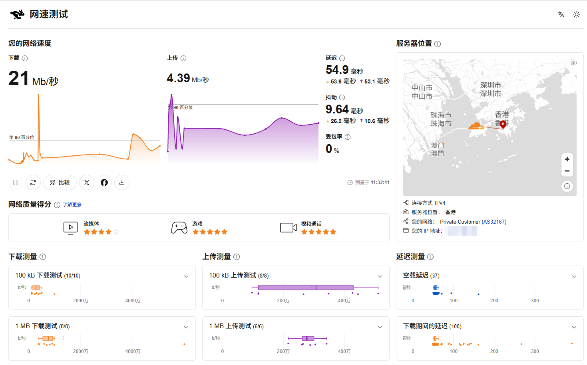
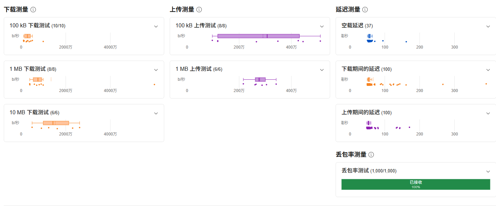
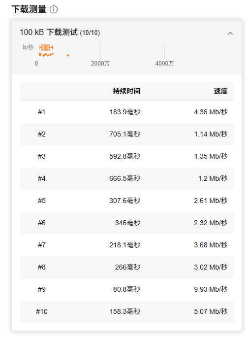
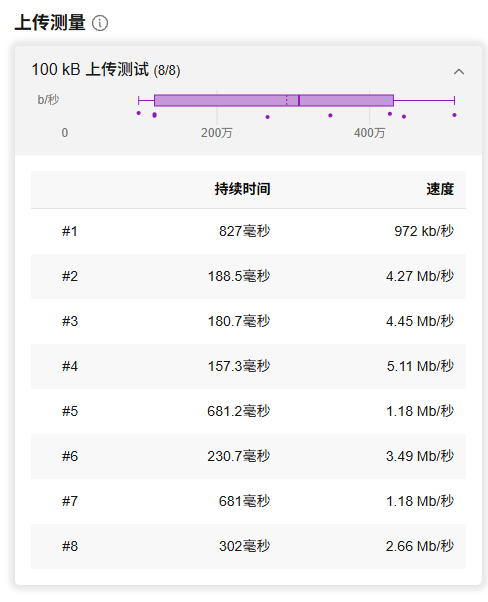
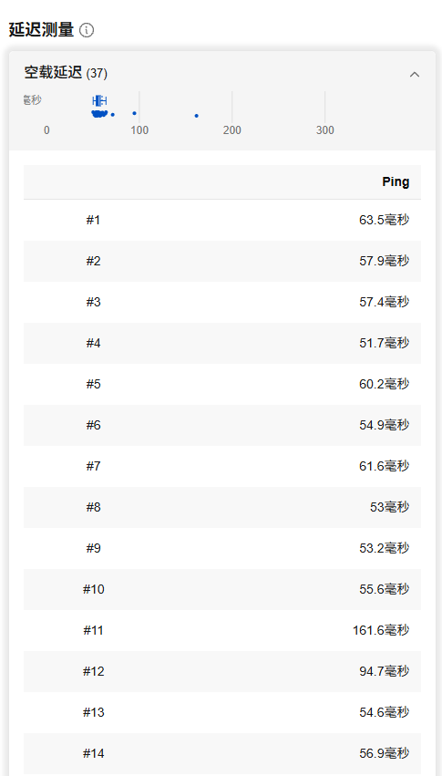
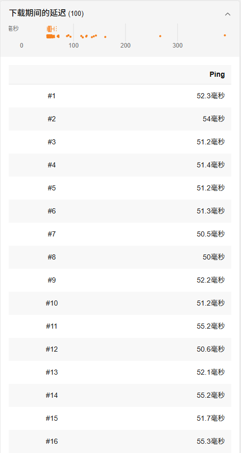
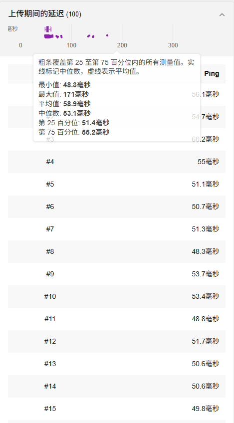
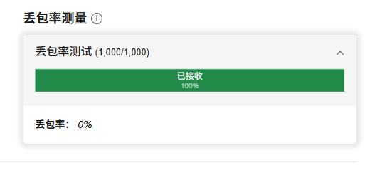
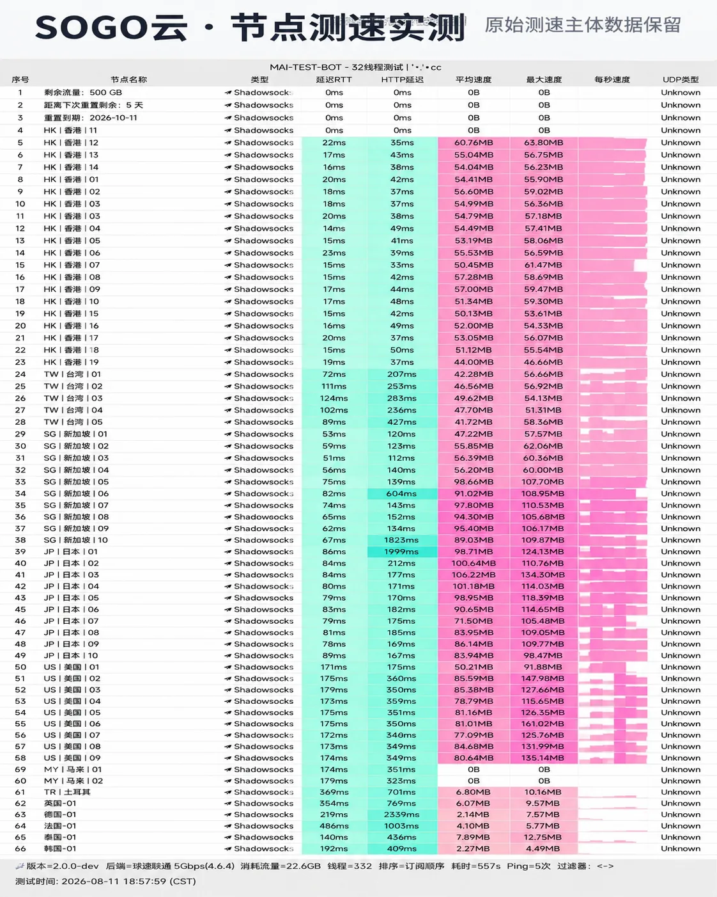

## SOGO云测速摘要

| 项目 | 当前结果 | 如何理解 |
| --- | --- | --- |
| 后台节点 | 待核验 | 不引用推测值 |
| 采集时在线 | 未知 | 不等于长期稳定性 |
| 地区覆盖 | 待核验 | 按后台节点名称归类 |
| 下载/上传 | 21 / 4.39 Mb/秒 | 2026-11-01 上午单轮结果 |
| 延迟/丢包 | 54.9 毫秒 / 0% | 测速服务器在香港，单轮结果 |
| 节点测速截图 | 62 个节点，RTT 14–486ms | 2026-08-11 傍晚单轮，见下文 |
| 晚高峰 | 尚未完成本站测试 | 上午结果不能代表晚高峰 |
| 流媒体/AI | 尚未完成本站测试 | 需要逐节点、逐平台复核 |

后台在线只说明监测系统在采集时收到了响应，不能证明晚高峰带宽、用户所在地到入口的路由或出口质量。正式结果必须记录本地基线、城市、运营商、设备、客户端、工具、测试服务器、日期与时段，并保留失败样本。

## 2026-11-01 Cloudflare 测速记录

下面的截图由站点管理者提供，测试工具是 Cloudflare 网速测试，测量时间为 **2026-11-01 11:32:41**，连接方式 IPv4，测速服务器位于香港。截图中的 IP 地址已打码，其他内容未修改。这次没有记录具体节点名称、本地宽带基线和客户端，所以结果只说明这一次连接的表现，不能说明节点或线路的带宽上限。

| 项目 | 结果 | 补充数据 |
| --- | --- | --- |
| 下载 | 21 Mb/秒 | 下载时延迟 53.6 毫秒 |
| 上传 | 4.39 Mb/秒 | 上传时延迟 53.1 毫秒 |
| 空载延迟 | 54.9 毫秒 | 37 次采样 |
| 抖动 | 9.64 毫秒 | 下载时 26.2 毫秒，上传时 10.6 毫秒 |
| 丢包率 | 0% | 1,000 个数据包全部收到 |
| 网络质量得分 | 流媒体 4 星 | 游戏 5 星，视频通话 5 星 |

这轮的延迟比较稳定：上传期间 100 次采样的中位数是 53.1 毫秒，第 25 到第 75 百分位在 51.4–55.2 毫秒，但最大值到了 171 毫秒，空载和下载期间也各有少量偏高的样本。下载和上传速度波动明显：100 kB 下载样本在 1.14–9.93 Mb/秒之间，100 kB 上传样本在 972 kb/秒到 5.11 Mb/秒之间。

### 分项原始数据

## 2026-08-11 节点测速截图

下面的截图由站点管理者提供，标题标注为SOGO云的节点测速。测试时间为 **2026-08-11 18:57:59（CST）**，MAI-TEST-BOT 2.0.0-dev，后端为联通 5Gbps，协议 Shadowsocks，共 62 个节点。本站没有独立复测，也拿不到原始测试日志，所以这里只把截图里的数字按地区整理出来，不作为本站实测结论。

| 地区 | 节点数 | 延迟 RTT | 平均速度 | 最高速度 |
| --- | ---: | --- | --- | --- |
| 香港 | 19 | 14–23ms | 44.00–60.76MB（香港11 为 0B） | 63.80MB |
| 台湾 | 5 | 72–124ms | 41.72–49.62MB | 58.36MB |
| 新加坡 | 10 | 51–82ms | 47.22–98.66MB | 110.53MB |
| 日本 | 10 | 78–89ms | 71.50–106.22MB | 134.30MB |
| 美国 | 9 | 171–179ms | 50.21–85.59MB | 161.02MB |
| 其他地区 | 8 | 140–486ms | 0B–7.89MB | 12.75MB |

速度单位沿用截图显示的 MB，不换算成 Mbps。截图前 3 行是套餐信息，没有计入节点数。其他地区包括马来西亚 2 个、土耳其、英国、德国、法国、泰国、韩国各 1 个。

SOGO云这一轮日本组最快，多数节点在 84–106MB；美国组平均 50–86MB，最高 161MB，是这一批截图里美国节点较好的。香港延迟很低（14–23ms），速度在 44–61MB，比较整齐。马来西亚 2 个节点为 0B，其他小地区都在 8MB 以下。

## 统一测试环境

正式测试会记录宽带运营商、所在城市、接入方式、有线或 Wi-Fi、设备型号、操作系统、客户端与核心版本。测试前先测本地基线，避免把家庭网络拥塞误算成机场问题。客户端规则、并发连接、测速服务器和单位也会固定并公开。

同一节点在普通时段与当地晚高峰分别重复测试，至少保留多次样本。报告展示中位数、范围和失败次数，不删除异常样本，也不以最高值代表常态。测试日期、时区、原始截图或日志摘要会与结论放在一起，使读者可以判断资料是否过期。

## 计划记录的指标

| 指标 | 记录方式 | 解释边界 |
| --- | --- | --- |
| 基线带宽 | 不连接代理时重复测试 | 仅用于说明本地上限 |
| 下载与上传 | 同一工具、同一节点多次测量 | 单次峰值不代表长期表现 |
| 延迟与抖动 | 固定目标并注明位置 | 受距离、路由和本地网络影响 |
| 丢包与失败 | 保留成功及失败样本 | 短时结果不能保证未来可用 |
| 流媒体与 AI | 逐平台、逐节点、逐时间验证 | 可打开不等于持续可用 |
| 线路路径 | 官网标注与必要的路由观察分列 | 不凭名称断言线路性质 |

## 怎样形成正式结论

只有在原始证据、环境说明和重复样本齐全时，页面才会加入数字摘要。不同节点会分别报告，不把少数优质节点推广为全网表现。套餐价格、流量倍率与性能会分开讨论，因为低价不必然代表性价比高，高速单次样本也不等于稳定。

任何结果都带有时间边界。机场可能调整入口、带宽、规则与节点，读者也可能因运营商、地区和设备得到不同结果。因此正式结论会写成“在某环境与某时段观察到”，不会写成永久保证。

## 资料入口与监督

测试完成前，可查看 [SOGO云 品牌资料页](/jichang/sogo-yun/)、[测试与评分方法](/methodology/)、[更正机制](/corrections/) 和 [联系页面](/contact/)。发现节点名称、套餐或结论过期时，请附可公开来源和采集时间，我们会复核并保留更正说明。

## 分品牌测试执行表

下面的矩阵把 SOGO云 当前资料转换为可执行测试任务。测试状态为空不表示性能差，只表示尚未产生合格证据。每组需要固定设备、客户端、测试服务器和本地基线，并保留至少三次结果。

| 地区或样本 | 节点范围 | 测试批次 | 时间窗口 | 当前状态 |
| --- | --- | --- | --- | --- |
| 首批代表节点 | 等待后台清单 | 第 1 组 | 普通时段 + 晚高峰 | 普通时段已测 1 轮，节点名称未记录，晚高峰待测 |
| 第二地区节点 | 等待后台清单 | 第 2 组 | 普通时段 + 晚高峰 | 未取得节点 |

### 每一批怎样记录

先断开代理测量本地基线，再连接目标节点。下载、上传、延迟和抖动使用相同工具重复采集；连接失败、超时和速度异常都保留。普通时段与晚高峰分开，不把不同时段的数据混成一个“平均速度”。如果节点临时离线，记录观察时间后换到同地区备用节点，但不能删除离线事实。

### 怎样避免误导性排名

不同品牌节点数量、入口位置和用户负载不同，单次速度不能直接排名。正式比较至少需要相同网络、设备、工具、时间窗口和样本数量。后台写有“专线、直连、原生、AI 解锁”等标签时，测试报告仍只报告实际观察，不用标签替代路由或平台验证。

### 结果页将怎样更新

取得真实日志后，本页会增加测试日期、本地基线、每组中位数、波动范围、失败次数和证据说明。只有可复查数据才进入摘要；无法复现或只有单张峰值截图的结果会放入备注，不进入推荐判断。更新历史通过 [更正机制](/corrections/) 保留，完整标准见 [测试方法](/methodology/)。

## 当前结论

SOGO云 目前有一轮 2026-11-01 上午的 Cloudflare 测速记录：下载 21 Mb/秒、上传 4.39 Mb/秒、延迟 54.9 毫秒、丢包 0%。这只是单轮结果，没有本地基线和节点名称，不代表晚高峰或其他节点的表现，也不作为本站排名依据。下一步是取得后台节点清单，记录本地基线，再按统一环境补齐晚高峰和多节点测试。另有一轮 2026-08-11 傍晚的 62 节点测速截图：日本、美国、新加坡速度较高，香港延迟最低但速度在 44–61MB，马来西亚 2 个节点为 0B。晚高峰和流媒体结果尚未完成，补齐之前本页不会作为完整测速报告提交给搜索引擎。

## 第三方测速资料与可比性

| 来源 | 发布者 | 类型 | 本次采集 | 可支持的内容 |
| --- | --- | --- | --- | --- |
| [SOGO云品牌入口](https://wzjc.sogoyunaff.cc/) | SOGO云 | 品牌入口/原始页面 | 2026-08-24 | 品牌注册或用户中心入口；购买前复核套餐与规则的原始入口 |
| [机场测速与公开资料索引](https://tizinodes.com/airport-test/) | TiziNodes | 第三方整理 | 2026-08-24 | 第三方公开资料分类；官网可达性监测口径 |
| [SOGO云公开资料与截图样本说明](https://www.ermao.net/blog/sogoyun/) | 二毛 | 第三方整理 | 2026-08-24 | 第三方套餐与客户端信息；截图样本的证据边界 |

二毛的页面说明其结论来自提供的测速截图，并明确提醒样本不代表所有地区与时段。这类截图可以证明曾出现过某次结果，但缺少完整原始日志时不进入本站性能排名。

第三方数据的价值是提供外部样本，不是替本站完成测试。不同来源的网络接入、城市、设备、客户端、并发、测速服务器和时段往往不同，因此本文不会把它们直接横向排名，也不会把 MB/s 与 Mbps 混用。只有来源明确给出的数字才会引用；没有测试方法或仅有营销结论的页面不进入结果表。
