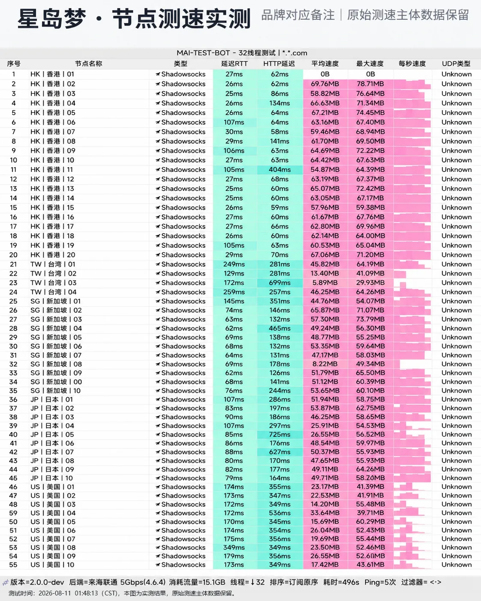

## 星岛梦测速摘要

| 项目 | 当前结果 | 如何理解 |
| --- | --- | --- |
| 后台节点 | 74 条记录 | 带采集时间的单次快照 |
| 采集时在线 | 68 条 | 不等于长期稳定性 |
| 地区覆盖 | 香港、台湾、新加坡、日本、美国、马来西亚、德国 | 按后台节点名称归类 |
| 下载 | 有 1 轮截图记录，见下表 | 2026-08-11 凌晨单轮结果 |
| 上传 | 尚未完成本站测试 | 不用理论带宽代替 |
| 延迟 | RTT 25–349ms | 地区差异大，按下表分地区看 |
| 丢包 | 尚未完成本站测试 | 不从地理距离推算 |
| 流媒体/AI | 尚未完成本站测试 | 需要逐节点、逐平台复核 |

后台在线只说明监测系统在采集时收到了响应，不能证明晚高峰带宽、用户所在地到入口的路由或出口质量。正式结果必须记录本地基线、城市、运营商、设备、客户端、工具、测试服务器、日期与时段，并保留失败样本。

## 2026-08-11 节点测速截图

下面的截图由站点管理者提供，标题标注为星岛梦的节点测速。测试时间为 **2026-08-11 01:48:13（CST）**，MAI-TEST-BOT 2.0.0-dev，后端为联通 5Gbps，32 线程，协议 Shadowsocks，共 55 个节点。本站没有独立复测，也拿不到原始测试日志，所以这里只把截图里的数字按地区整理出来，不作为本站实测结论。

| 地区 | 节点数 | 延迟 RTT | 平均速度 | 最高速度 |
| --- | ---: | --- | --- | --- |
| 香港 | 20 | 25–107ms | 54.87–69.76MB（香港01 为 0B） | 78.71MB |
| 台湾 | 4 | 129–259ms | 5.89–46.25MB | 64.26MB |
| 新加坡 | 11 | 62–145ms | 8.22–65.87MB | 73.79MB |
| 日本 | 10 | 79–107ms | 25.91–53.87MB | 64.26MB |
| 美国 | 10 | 170–349ms | 14.20–33.64MB | 60.29MB |

速度单位沿用截图显示的 MB，不换算成 Mbps。测试时间在凌晨，不是晚高峰，晚高峰表现可能更差。

星岛梦香港组比较整齐，19 个有速度的节点都在 55–70MB。台湾、美国偏慢，台湾03 只有 5.89MB，美国多数在 14–27MB。新加坡08 只有 8.22MB。

## 已核验的节点后台快照

以下内容来自站点管理者登录 星岛梦 后台后提供的节点列表，采集时间为 **2026-08-24 14:21–14:34（Asia/Kuala_Lumpur）**。它属于一次后台状态快照，不是独立测速，也不能证明节点在其他时间、网络或地区仍然在线。

本次共收到 **74 条节点记录**，其中后台显示在线 **68 条**、离线 **6 条**；倍率均为 **1x**。协议字段：VLESS。

| 地区或类别 | 后台节点名称范围 | 记录数 | 当时在线 | 倍率 | 说明 |
| --- | --- | ---: | ---: | ---: | --- |
| 香港 | 香港企业专线/BGP/精品中转/极速中转 | 18 | 17 | 1x | ID 15 离线；缺 13、17 |
| 台湾 | 台湾 01–05（名称含 AI 标签） | 5 | 5 | 1x | 后台原文分组 |
| 新加坡 | 新加坡 01–10（企业/全栈/精品中转） | 10 | 10 | 1x | 后台原文分组 |
| 日本 | 日本 BGP 01–10、直连 01–04 | 14 | 14 | 1x | 名称含原生、AI、CN2 标签 |
| 美国 | 美国 01–10、直连 01–04 | 14 | 13 | 1x | ID 52 离线 |
| 马来西亚 | 马来西亚 01–02 | 2 | 2 | 1x | 后台原文 |
| 德国 | 德国直连-CN2优化01–04 | 4 | 0 | 1x | 4 条均离线 |
| 其他 | 英国、法国、菲律宾、土耳其、巴西 | 5 | 5 | 1x | 各 1 条 |
| 备用 | 防失联-日本、德国直连 | 2 | 2 | 1x | 后台原文 |

> 核验边界：“AI优选、AI解锁、GPT/Gemini、企业专线、BGP、原生落地、CN2优化”均为节点名称的一部分，尚未逐项验证。多个离线节点含 1970 时间异常。 节点名称中的 BGP、IEPL、直连、Cloud 等词均视为运营方标签，除非后续有路由记录或其他证据，否则不升级为编辑部事实判断。

## 统一测试环境

正式测试会记录宽带运营商、所在城市、接入方式、有线或 Wi-Fi、设备型号、操作系统、客户端与核心版本。测试前先测本地基线，避免把家庭网络拥塞误算成机场问题。客户端规则、并发连接、测速服务器和单位也会固定并公开。

同一节点在普通时段与当地晚高峰分别重复测试，至少保留多次样本。报告展示中位数、范围和失败次数，不删除异常样本，也不以最高值代表常态。测试日期、时区、原始截图或日志摘要会与结论放在一起，使读者可以判断资料是否过期。

## 计划记录的指标

| 指标 | 记录方式 | 解释边界 |
| --- | --- | --- |
| 基线带宽 | 不连接代理时重复测试 | 仅用于说明本地上限 |
| 下载与上传 | 同一工具、同一节点多次测量 | 单次峰值不代表长期表现 |
| 延迟与抖动 | 固定目标并注明位置 | 受距离、路由和本地网络影响 |
| 丢包与失败 | 保留成功及失败样本 | 短时结果不能保证未来可用 |
| 流媒体与 AI | 逐平台、逐节点、逐时间验证 | 可打开不等于持续可用 |
| 线路路径 | 官网标注与必要的路由观察分列 | 不凭名称断言线路性质 |

## 怎样形成正式结论

只有在原始证据、环境说明和重复样本齐全时，页面才会加入数字摘要。不同节点会分别报告，不把少数优质节点推广为全网表现。套餐价格、流量倍率与性能会分开讨论，因为低价不必然代表性价比高，高速单次样本也不等于稳定。

任何结果都带有时间边界。机场可能调整入口、带宽、规则与节点，读者也可能因运营商、地区和设备得到不同结果。因此正式结论会写成“在某环境与某时段观察到”，不会写成永久保证。

## 资料入口与监督

测试完成前，可查看 [星岛梦 品牌资料页](/jichang/xingdaomeng/)、[测试与评分方法](/methodology/)、[更正机制](/corrections/) 和 [联系页面](/contact/)。发现节点名称、套餐或结论过期时，请附可公开来源和采集时间，我们会复核并保留更正说明。

## 分品牌测试执行表

下面的矩阵把 星岛梦 当前资料转换为可执行测试任务。测试状态为空不表示性能差，只表示尚未产生合格证据。每组需要固定设备、客户端、测试服务器和本地基线，并保留至少三次结果。

| 地区或样本 | 节点范围 | 测试批次 | 时间窗口 | 当前状态 |
| --- | --- | --- | --- | --- |
| 香港 | 香港企业专线/BGP/精品中转/极速中转 | 第 1 组 | 普通时段 + 晚高峰 | 等待实测 |
| 台湾 | 台湾 01–05（名称含 AI 标签） | 第 2 组 | 普通时段 + 晚高峰 | 等待实测 |
| 新加坡 | 新加坡 01–10（企业/全栈/精品中转） | 第 3 组 | 普通时段 + 晚高峰 | 等待实测 |
| 日本 | 日本 BGP 01–10、直连 01–04 | 第 4 组 | 普通时段 + 晚高峰 | 等待实测 |
| 美国 | 美国 01–10、直连 01–04 | 第 5 组 | 普通时段 + 晚高峰 | 等待实测 |
| 马来西亚 | 马来西亚 01–02 | 第 6 组 | 普通时段 + 晚高峰 | 等待实测 |
| 德国 | 德国直连-CN2优化01–04 | 第 7 组 | 普通时段 + 晚高峰 | 等待实测 |
| 其他 | 英国、法国、菲律宾、土耳其、巴西 | 第 8 组 | 普通时段 + 晚高峰 | 等待实测 |

### 每一批怎样记录

先断开代理测量本地基线，再连接目标节点。下载、上传、延迟和抖动使用相同工具重复采集；连接失败、超时和速度异常都保留。普通时段与晚高峰分开，不把不同时段的数据混成一个“平均速度”。如果节点临时离线，记录观察时间后换到同地区备用节点，但不能删除离线事实。

### 怎样避免误导性排名

不同品牌节点数量、入口位置和用户负载不同，单次速度不能直接排名。正式比较至少需要相同网络、设备、工具、时间窗口和样本数量。后台写有“专线、直连、原生、AI 解锁”等标签时，测试报告仍只报告实际观察，不用标签替代路由或平台验证。

### 结果页将怎样更新

取得真实日志后，本页会增加测试日期、本地基线、每组中位数、波动范围、失败次数和证据说明。只有可复查数据才进入摘要；无法复现或只有单张峰值截图的结果会放入备注，不进入推荐判断。更新历史通过 [更正机制](/corrections/) 保留，完整标准见 [测试方法](/methodology/)。

## 当前结论

星岛梦 目前有一轮 2026-08-11 凌晨的节点测速截图：香港速度整齐，日本、新加坡中等，台湾和美国偏慢。凌晨不是高峰时段，这个结果偏乐观。这只是站点管理者提供的单轮截图，本站没有独立复测，不代表现在或长期表现，也不作为本站排名依据。上传、丢包、流媒体和 AI 平台的结果尚未完成，补齐之前本页不会作为完整测速报告提交给搜索引擎。

## 第三方测速资料与可比性

| 来源 | 发布者 | 类型 | 本次采集 | 可支持的内容 |
| --- | --- | --- | --- | --- |
| [星岛梦品牌入口](https://kfccbb.xingdaomeng.com/) | 星岛梦 | 品牌入口/原始页面 | 2026-08-24 | 品牌注册或用户中心入口；购买前复核套餐与规则的原始入口 |
| [机场测速与公开资料索引](https://tizinodes.com/airport-test/) | TiziNodes | 第三方整理 | 2026-08-24 | 第三方公开资料分类；官网可达性监测口径 |

本轮公开检索没有找到同时具备明确测试日期、网络环境、工具、节点样本和原始记录的独立性能报告。为了避免用搜索摘要或营销转载补数字，本文保留“尚无可复现第三方测速”的结论；读者仍可通过上表入口复核当前套餐与规则。

第三方数据的价值是提供外部样本，不是替本站完成测试。不同来源的网络接入、城市、设备、客户端、并发、测速服务器和时段往往不同，因此本文不会把它们直接横向排名，也不会把 MB/s 与 Mbps 混用。只有来源明确给出的数字才会引用；没有测试方法或仅有营销结论的页面不进入结果表。
